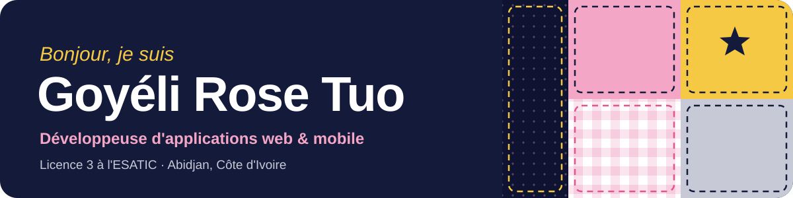

  

  

  
  
  

---

### Bonjour, moi c'est Goyéli Rose

Étudiante en **Licence 3 Technologies du Web et Images Numériques** à l'**ESATIC**, je développe des applications web et mobiles, de la maquette Figma jusqu'à la mise en ligne.

Je suis passionnée par la résolution des problèmes sociaux : je crois que la technologie est le meilleur moyen de rendre la vie simple et belle, à condition d'être pensée à partir de nos réalités africaines.

- 🌸 En ce moment, je suis **chef de projet et développeuse front-end** sur [FlowManage](https://github.com/rtuo1978-a11y/Floodge), une application de prévention des inondations en Côte d'Ivoire.
- 👑 **Finaliste Miss CI Informatique 2026** avec YALA, un assistant vocal de services financiers pour les femmes.
- 🏆 **Prix Technovore**, Hackathon ESATIC 2026, pour N'Zassa.
- ⭐ **Coup de cœur du jury, Les Margaret Africa Junior 2021**, pour X-Market, à 15 ans.
- 💼 Développeuse front-end chez **Frony** de mars à octobre 2026.
- 🔎 Je cherche un **stage de fin de cycle de 3 à 6 mois** à Abidjan.

 

### Mes projets

| Projet | Ce que ça fait | Avec |
| --- | --- | --- |
| [**FlowManage**](https://github.com/rtuo1978-a11y/Floodge) | Prévenir et gérer les risques d'inondation : alertes, carte des zones à risque, IA | React Native, NestJS, Supabase, Prisma, Google Maps |
| **YALA** | Un assistant vocal pour que les femmes, même celles qui ne savent pas lire, gèrent leur argent seules (finaliste Miss CI Informatique 2026) | React Native, Django REST |
| **N'Zassa** | Apprendre et conserver la culture ivoirienne (Prix Technovore 2026) | Figma, web |
| **X-Market** | Suivre l'urbanisation et organiser les commerces au bord des routes | Mobile |
| **Gestion de restaurant** | Un SaaS pour gérer un restaurant, en ligne | Django, PythonAnywhere |
| **Système d'information d'usine** | Gestion d'usine, en sprints Scrum | Django, YouTrack |
| [**Apotheosis ACE**](https://github.com/rtuo1978-a11y/acevent) | Organiser le banquet d'une église : tables, menu, choix des plats | Django, React, Django REST |
| **SmartMetter** | Conception d'un système de compteurs électriques intelligents pour la CIE : paiement en ligne, validation par IA, remise en service par IoT | React, Node.js, IoT, MQTT |

  
  
  

FlowManage et Apotheosis ACE en images. Toutes les captures sont sur <a href="https://rtuo1978-a11y.github.io/PortfolioRose/#projets">mon portfolio</a>.

### Ma boîte à outils

  

### Mon activité sur GitHub

  
  

  

  <picture>
    <source media="(prefers-color-scheme: dark)" srcset="https://raw.githubusercontent.com/rtuo1978-a11y/rtuo1978-a11y/output/snake-nuit.svg">
    <source media="(prefers-color-scheme: light)" srcset="https://raw.githubusercontent.com/rtuo1978-a11y/rtuo1978-a11y/output/snake-clair.svg">
    
  </picture>

### Certifications

Introduction to Modern AI (Cisco) · HTML Essentials (Cisco et JS Institute) · English for IT 2 (Cisco et OpenEDG) · CCNA 1 (Africa DigiEmpower) · FlutterFire Summer Camp

  

